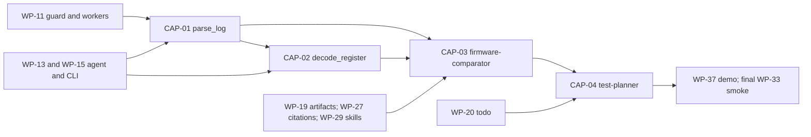

# First tools and skills

Status: planned 2026-10-09; documentation only. No product code is implemented by this package.

This package covers the four capabilities selected by the user: two internal read tools and two
Agent Skills. It supplements the 38 base work packages; CAP IDs identify these additions without
renumbering the base plan. Read [shared contracts](contracts.md), then a capability's SPEC and PLAN.
This is a separate planning package. Dependencies below refer to existing capabilities; the main
plan and its milestone acceptance criteria are not changed by these documents.

| ID | Capability | Kind | Spec | Implementation plan | Ready after |
|---|---|---|---|---|---|
| CAP-01 | parse_log | Internal read tool | [SPEC](tools/parse_log/SPEC.md) | [PLAN](tools/parse_log/PLAN.md) | WP-11, WP-13, WP-15 |
| CAP-02 | decode_register | Internal read tool | [SPEC](tools/decode_register/SPEC.md) | [PLAN](tools/decode_register/PLAN.md) | CAP-01 shared host adapter; WP-11, WP-13, WP-15 |
| CAP-03 | firmware-comparator | Agent Skill | [SPEC](skills/firmware-comparator/SPEC.md) | [PLAN](skills/firmware-comparator/PLAN.md) | CAP-01, CAP-02, WP-19, WP-27, WP-29 |
| CAP-04 | test-planner | Agent Skill | [SPEC](skills/test-planner/SPEC.md) | [PLAN](skills/test-planner/PLAN.md) | CAP-03, WP-20 |

## Intended result

On one workbench, the user can parse two captured logs, decode a captured register value, compare
two firmware runs using their recorded conditions, and prepare a small test plan with cited
expectations. The skills produce session artifacts. Hardware measurements and execution remain
manual, as in the existing v1 scope.

## Sequence and milestones

1. Build the base file guard, registry and bounded worker host of WP-11.
2. CAP-01: implement schemas and a streaming parser, then prove the agent and CLI adapters after
   WP-13/WP-15. Its shared run-record schema also supplies comparison inputs.
3. CAP-02: implement local register definitions and numeric decoding, then the same adapters.
4. After document citations, artifacts and skill loading exist, implement CAP-03 and CAP-04 on
   copies of a fixture workbench. They are functional M3 deliverables; WP-37 packages their samples
   with the complete verification fixture in M5.
5. Include their tests in `verify`, their scripts in e2e, and their assets/scenarios in the final
   release smoke of WP-33. Existing context budgets and result limits apply to every new tool call.

## First slice and assumptions

- Start with the fictional VERA-DEMO-01 board, revision A, and a documented `vera-log-v1` format.
  These fixtures prove mechanics; they do not claim compatibility with a real firmware's log format.
- Register definitions are small local JSON files. CMSIS-SVD import, register reads from a device,
  arbitrary parser profiles and trace formats are follow-up work.
- The firmware comparison uses captured run records, not firmware binary disassembly. The test
  planner writes procedures; it has no test runner or evaluator catalog.
- A real pilot replaces the sample log/profile and register definitions only after its board,
  firmware format, source documentation and representative captures are identified. The generic
  contracts and synthetic tests can be implemented before that domain review.

## Execution and review

Every source path under `05_Software/` in these plans is a proposed implementation path. Currently
that folder contains only its README. Commands in PLAN files are future verification commands,
not evidence that software tests have already passed.

The repository's AGENTS.md excludes planning documents from AEGIS. Product implementation follows
AEGIS once execution is requested. Each task uses a failing behavioural test, implementation and
focused verification. This package defines implementation work and acceptance criteria directly,
without an additional planning or execution framework. No implementation or commit is performed by
this planning task.

Source procedures to adapt, from the reference code:
[firmware-comparator](../../09_Others/benchpilot-reference/skills/firmware-comparator/SKILL.md) and
[test-planner](../../09_Others/benchpilot-reference/skills/test-planner/SKILL.md). Their unavailable catalog/execution tools
must be replaced with VERA's documented file, document, artifact and todo tools.
