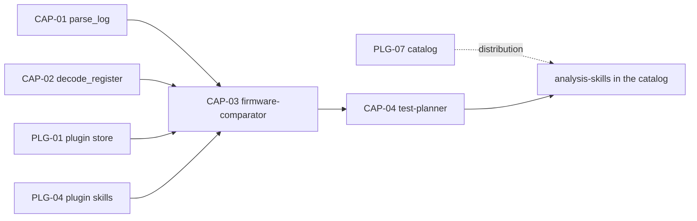

# Analysis capabilities

PURPOSE: four capabilities that turn captured logs, register values and documents into cited
engineering evidence: two internal VERA tools and two Agent Skills.
DONE-WHEN: CAP-01…CAP-04 pass their acceptance on Windows x64 and Linux x64, and the two skills ship
in the official `analysis-skills` plugin.
STATUS: rewritten 2026-11-01 for the plugin architecture (`../plugins/`) and the code at commit
33e72b8; nothing implemented yet. Tracked in Gitea: milestone "Analysis capabilities", epic #75.
The 2026-10-09 version used a fictional `vera-log-v1` log format and a RunRecord v1 metadata schema;
both are dropped.

## 1. Where a capability belongs

| Kind | Use when | Examples |
|---|---|---|
| Skill | a Markdown procedure on existing tools is enough | `firmware-comparator`, `test-planner` |
| Internal VERA tool | every workbench needs it and its results must be citable line references (`path#Lstart-Lend`) that VERA's citation check verifies | `parse_log`, `decode_register` |
| Plugin | an external program or hardware is needed | ESP32 panic decoding (`esp32-idf`, #66), CAN decoding with DBC (#70), live register reads (OpenOCD/GDB), test execution |

## 2. Capabilities

| ID | Capability | Kind | Spec | Plan | Depends on | Gitea |
|---|---|---|---|---|---|---|
| CAP-01 | `parse_log` | internal `read` tool | [SPEC](tools/parse_log/SPEC.md) | [PLAN](tools/parse_log/PLAN.md) | existing registry and worker host | #76 |
| CAP-02 | `decode_register` | internal `read` tool | [SPEC](tools/decode_register/SPEC.md) | [PLAN](tools/decode_register/PLAN.md) | existing registry | #77 |
| CAP-03 | `firmware-comparator` | skill in `analysis-skills` | [SPEC](skills/firmware-comparator/SPEC.md) | [PLAN](skills/firmware-comparator/PLAN.md) | CAP-01, CAP-02, PLG-01 #57, PLG-04 #60 | #78 |
| CAP-04 | `test-planner` | skill in `analysis-skills` | [SPEC](skills/test-planner/SPEC.md) | [PLAN](skills/test-planner/PLAN.md) | CAP-03 | #79 |

Shared rules for all four: [contracts.md](contracts.md).

## 3. Order

CAP-01 and CAP-02 are independent of each other and of the plugin platform. The skills need the
plugin store and plugin skills; catalog distribution follows PLG-07 (#63).

## 4. Result on the demo workbench

The fixture `tests/fixtures/workbenches/demo-board/` gains a second boot log with an I2C error, run
notes, a boot criterion, release notes and a register definition (contracts §5). On it, the agent
parses both logs with cited events, decodes `I2C1_CR1`, compares the two firmware runs into a cited
report and writes a sourced manual test plan.

NOTES:
- Implementation follows the repository's AEGIS workflow, one capability per task.
- Gitea issue bodies are self-contained; these documents are their local planning source.
