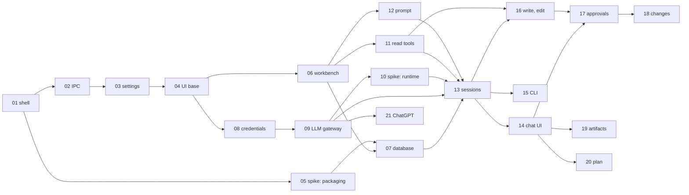

# VERA implementation plan

PURPOSE: the order in which VERA 1.0 is built — milestones, work packages, dependencies and risks —
and the decisions taken with the user that shape it. Specs: `../architecture/`; decisions: `../decisions/`.
STATE: 2026-10-09 — planned; nothing implemented yet.

## 1. Decisions taken with the user (2026-10-09)

- Code from the earlier BenchPilot proof of concept is reused; its snapshot is in
  `09_Others/benchpilot-reference/`. Every work package names the files it starts
  from; the full map is [benchpilot-reuse.md](benchpilot-reuse.md).
- ChatGPT-subscription sign-in is acceptable for the way VERA will be distributed.

## 2. Milestones

| Milestone | Plan | DONE-WHEN |
|---|---|---|
| **M0 Foundation** | [M0-foundation.md](M0-foundation.md) | the launch e2e passes on Windows and Ubuntu with the security baseline (01 §7); theme, text size and language switch and persist; the packaging spike WP-05 has filed its ADR |
| **M1 Read-only agent** | [M1-read-only-agent.md](M1-read-only-agent.md) | the agent reads and cites files; every request fits its context budget, including a long first turn; grep timeout/abort leaves IPC responsive; sessions survive restart; `vera run` prints the same events headless; real-provider smoke is manual |
| **M2 Edits, artifacts, ChatGPT** | [M2-edits-artifacts-chatgpt.md](M2-edits-artifacts-chatgpt.md) | approval is bound to one exact change and used once; sessions share one write queue per workbench; restart recovers interrupted approvals and writes; protected paths ask even in `auto-edit`; panels and ChatGPT sign-in work |
| **M3 Knowledge** | [M3-knowledge.md](M3-knowledge.md) | demo PDFs, Markdown and logs index in the background; hybrid `search_docs` meets the recall threshold; citations open the viewer at the cited page; skills load from workbench and user folders |
| **M4 Delivery** | [M4-delivery.md](M4-delivery.md) | release artifacts install and index offline on both systems; a scripted loopback endpoint drives the normal provider path; the egress check finds no unexpected connection; vN → vN+1 preserves data |
| **M5 Version 1.0** | [M5-version-1.md](M5-version-1.md) | historical compaction extends the M1 context budget; messages can be sent during a turn; sessions export; demo and onboarding ship; translations reviewed; final 1.0 release smoke passes |

## 3. Work packages

| WP | Title | Milestone | Depends on |
|---|---|---|---|
| WP-01 | Electron shell and source skeleton | M0 | — |
| WP-02 | Shared contracts and the typed IPC bridge | M0 | 01 |
| WP-03 | App data locations, settings and logging | M0 | 02 |
| WP-04 | UI foundation: layout, themes, text size, languages | M0 | 03 |
| WP-05 | Spike: native modules and the embedding model in packaged builds | M0 | 01 |
| WP-06 | Workbench format, create and open, Welcome screen | M1 | 04 |
| WP-07 | Workbench database and migrations | M1 | 05, 06 |
| WP-08 | Credential store and provider settings | M1 | 04 |
| WP-09 | LLM gateway, connection test, replay provider | M1 | 08 |
| WP-10 | Spike: agent runtime | M1 | 09 |
| WP-11 | Path guard, tool registry, read-only file tools | M1 | 06 |
| WP-12 | System prompt builder | M1 | 06 |
| WP-13 | Session engine | M1 | 07, 09, 10, 11, 12 |
| WP-14 | Chat UI | M1 | 04, 13 |
| WP-15 | Headless CLI | M1 | 13 |
| WP-16 | Write and edit tools | M2 | 11, 13 |
| WP-17 | Permission modes and approvals | M2 | 14, 16 |
| WP-18 | Changes panel | M2 | 17 |
| WP-19 | Session artifacts | M2 | 14 |
| WP-20 | Plan tool and panel | M2 | 14 |
| WP-21 | ChatGPT subscription sign-in | M2 | 09 |
| WP-22 | Ingest pipeline | M3 | 07 |
| WP-23 | Extraction, chunking, demo documents | M3 | 22 |
| WP-24 | Spike: embedding model | M3 | 05, 23 |
| WP-25 | Keyword index | M3 | 23 |
| WP-26 | Embeddings, hybrid search, document tools | M3 | 24, 25 |
| WP-27 | Citations for every reference kind | M3 | 26 |
| WP-28 | Document viewer and Docs panel | M3 | 27 |
| WP-29 | Skills | M3 | 12 |
| WP-30 | Packaging targets | M4 | 05, 26 |
| WP-31 | Auto-update | M4 | 30 |
| WP-32 | Upgrade and migration safety | M4 | 17, 30 |
| WP-33 | Release-package smoke and egress check | M4 | 18, 28, 30, 31, 32 |
| WP-34 | Advanced context compaction | M5 | 10, 13, 14 |
| WP-35 | Messages during a running turn | M5 | 13, 14 |
| WP-36 | Session export and search | M5 | 13 |
| WP-37 | Demo workbench, sample skills, onboarding | M5 | 29 |
| WP-38 | Accessibility and translation pass | M5 | all UI packages |

## 4. Dependencies, M0–M2

Critical path: WP-01 → 02 → 03 → 04 → 08 → 09 → 10 → 13 → 14 → 17. The packaging spike WP-05 runs
in parallel from WP-01 and must finish before the database (WP-07).

## 5. Risks

| ID | Risk | Mitigation | Watch in |
|---|---|---|---|
| R-01 | pi-ai changes its API | exact pin; one wrapper module; replay tests | WP-09 |
| R-02 | A native module (better-sqlite3, onnxruntime-node) fails in a packaged build | spike in M0; plan B `node:sqlite`; WASM ONNX backend as last resort | WP-05 |
| R-03 | The ChatGPT sign-in flow changes on OpenAI's side | isolated module; API key and local endpoints keep working | WP-21 |
| R-04 | Local models call tools poorly | the connection test flags tool support; UI warning | WP-09 |
| R-05 | Datasheet PDFs extract badly (multi-column pages, tables) | page-level citations; `read_doc` page ranges; evaluation on demo PDFs; tables and OCR after 1.0 | WP-23, WP-24 |
| R-06 | Prompt injection through documents | the defences of 03 §10 | every tool package |
| R-07 | The package exceeds its size budget | size check; smaller English model as fallback | WP-30 |
| R-08 | Agent-written code drifts from the architecture | laws of 01 §1, the boundary check, review of every work package | all |
| R-09 | A first turn or model switch exceeds context before historical compaction | budget every request from M1, including current-turn tool results; reserve output; explicit limit outcome | WP-09, WP-10, WP-13, WP-34 |
| R-10 | Concurrent or interrupted edits apply stale or repeated approvals | approval bound to the change's digest and used once; one write queue per workbench; hash check before writing; `pending` changes resolved on restart | WP-16, WP-17, WP-32 |
| R-11 | A pathological grep blocks the main process or ignores Stop | regex work in a terminable worker; host deadline and abort; responsiveness test | WP-11, WP-14, WP-15 |
| R-12 | Instrumented-build results hide a release packaging or egress defect | separate artifacts; smoke on the release artifact by SHA-256; `strace` egress check on Ubuntu, Sandbox check on Windows | WP-30, WP-33 |

## 6. After 1.0

| Direction | Seam already in 1.0 |
|---|---|
| Wrapper tools: declared external programs (STM32 and ESP32 flashers, `sigrok-cli`, scripts) with typed parameters, fixed argument templates, policy, timeout, success criteria and process-tree termination | `<workbench>/tools/`; an operation descriptor with input schema, policy, timeout and resources; ADR-0007; the spawn pattern of `09_Others/benchpilot-reference/apps/server/src/tshark.ts` (argument array, no shell, timeout, output cap) |
| Serial terminal and logging | `serialport`; a `devices` module in core |
| Camera snapshots and live view | `getUserMedia`; the permission handler of 01 §7 |
| Voice: local speech-to-text, optional text-to-speech | `SpeechToText` port; the ONNX runtime shipped for embeddings (06 §9) |
| Test catalog with deterministic evaluators | test definitions with machine-checked criteria; VERA's artifacts and references as evidence |
| Anthropic and Azure OpenAI providers | ADR-0002 |
| `apply_patch` for Codex-trained models; image input | the tool registry |
| macOS | ADR-0001 |
