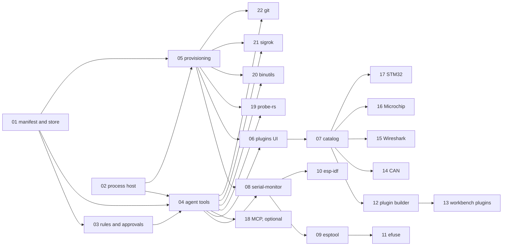

# Plugins — implementation plan

PURPOSE: the order in which the plugin system of [architecture.md](architecture.md) and the ESP32
pack of [packs.md](packs.md) are built: work packages PLG-01…PLG-22, dependencies, verification and
risks.
DONE-WHEN: steps 1 and 2 are complete. On Windows x64 and Linux x64 a user installs the ESP32 pack
from the catalog and asks the agent to identify, build, flash and monitor a real ESP32 board; the
release smoke covers the approval card, the typed confirmation and process-tree termination.
STATUS: decisions accepted 2026-11-01. PLG-01 (manifest schema, plugin store, per-workbench enablement; AEGIS
TASK-0cb6ef0f), PLG-02 (process host and runner; TASK-50789c10) and PLG-03 (rules, risk levels and approvals;
TASK-9b39247f) are implemented; otherwise nothing is implemented yet except PLG-05's removal of the size
checks. Builds on code that already exists: skill catalog, approvals bound to `requestSha256`,
permission modes, tool registry. Implementation follows the repository's AEGIS workflow
(CLAUDE.md), one work package per task. Gitea tracks each work package as one issue.

## 1. Order

| Step | Packages | Result |
|---|---|---|
| 1 First ESP32 flash | PLG-01…PLG-05, PLG-08, PLG-09 | with a plugin installed from a folder, the agent identifies and flashes an ESP32 on both systems; the desktop app shows approval cards |
| 2 Complete ESP32 pack and catalog | PLG-06, PLG-07, PLG-10, PLG-11, PLG-12 | plugins are managed in Settings and installed from the catalog; ESP-IDF builds and eFuse reads work; the agent drafts plugins |
| 3 Growth | PLG-13…PLG-18 | workbench plugins; first CAN, Wireshark, Microchip and STM32 plugins; optional MCP adapter |
| Bench tools | PLG-19…PLG-22 | vendor-neutral `probe-rs`, `binutils`, `sigrok` and `git` plugins; each can start once PLG-04 and PLG-05 exist, independently of steps 2 and 3 |

| Gitea epic and milestone | Epic issue | Packages |
|---|---|---|
| Plugins - platform | #54 | PLG-01…PLG-07, PLG-12, PLG-13, PLG-18 |
| Plugins - ESP32 pack | #55 | PLG-08…PLG-11 |
| Plugins - more ecosystems | #56 | PLG-14…PLG-17 |
| Plugins - bench tools | #80 | PLG-19…PLG-22 |

Gitea issue of each package: PLG-01…PLG-18 are #57…#74 in order (PLG-n is issue #(56 + n)); PLG-19…PLG-22 are #81…#84.
Created 2026-11-01 without ADORE labels.

PLG-01 and PLG-02 have no mutual dependency and can run in parallel.

## 2. Work packages

### PLG-01 Manifest schema and plugin store
**Goal:** install, validate, list and enable plugins from a folder or zip. **Depends on:** —.
**Specs:** architecture §2.1, §6.
- zod schema for `plugin.yaml` format 1 in `shared`; validation errors listed per plugin in the UI and
  over IPC, the way skills report `skillErrorSchema` errors.
- Store under `<userData>/plugins/installed/<id>/` with `install.json`; integrity hash over sorted
  paths and bytes, recomputed at load; mismatch → disabled "changed since review".
- `plugins: { enabled }` in `workbench.yaml` (`shared/src/workbench.ts`), with patch
  support and `UNKNOWN_NAME` warnings.
**Done when:** a fixture plugin installs from a folder and from a zip, survives restart, is disabled
after a file changes, and enabling it for one workbench does not enable it for another.

### PLG-02 Process host and runner
**Goal:** run a declared executable safely on Windows and Linux. **Depends on:** —.
**Specs:** architecture §3.2, §3.3.
- `ProcessHost` port in `core/src/ports.ts`; desktop main and CLI implementations; core never imports
  `child_process`.
- No shell, closed stdin, minimal environment, `cwd` through the path guard, timeout, process-tree
  kill (`taskkill /T /F`; process group with SIGTERM then SIGKILL), UTF-8 decoding with ANSI
  stripping, logs in `.vera/runs/` (newest 200), background registry (≤ 4 per session, killed on
  stop, close and exit), serial-port guard, launcher quoting.
**Done when:** tests with the `echo-program` fixture prove argument fidelity (spaces, quotes,
Unicode), timeout and Stop killing a grandchild process on both systems, output capping, log
retention and the serial-port refusal.
- Done 2026-11-02: `ProgramRunner` and `NodeProcessHost` in core, injected `spawn` in desktop main and
  the CLI, `tests/fixtures/echo-program`. Real-process tests ran on Windows x64; the Linux process
  group and SIGTERM/SIGKILL branches are unit-tested, and `tests/integration/process-hosts.test.ts`
  still needs a native Linux x64 run. The manifest field for the launcher mode moves to PLG-10.
  The serial-port guard reads `RunRequest.args`; with a one-string launcher the ports sit inside one
  quoted argument, so PLG-04/PLG-10 must check the program's own arguments, not the launcher's.

### PLG-03 Rules, risk levels and approvals
**Goal:** every command gets a risk level and the matching approval behaviour, in core and in the
desktop app. **Depends on:** PLG-01. **Specs:** architecture §2.2, §4.
- Matcher: `_`→`-` and lowercase normalisation, `*`, `{a,b}`, prefix tokens, highest risk wins,
  unmatched → `device-write`, pre-rule refusals (`@` arguments, NUL, newlines, size limits).
- `ChangeRequest` variant `run_program` with `files` hashes; the mode matrix of §4; irreversible
  commands need the typed confirmation in `ask` and `auto-edit`, checked in core, and run in
  `bypass` with `decided_by: mode`; every command of a `trial` plugin waits for a user approval in
  every mode, `bypass` included, and its irreversible commands need the typed word there too.
- Approval card for `run_program` in the chat: risk badge, program and version, full command, rule
  notes, file hashes; a typed field for irreversible commands.
- Bypass warning: switching a session to `bypass` lists the irreversible rules of its enabled
  plugins.
- All strings through i18n (`en`, `ro`, `de`).
**Done when:** table-driven tests cover every row of the mode matrix, highest-wins with several
subcommands, both spellings, an unmatched command, an `@file` argument, a changed image file voiding
an approval, a wrong typed word being refused, and a trial plugin's `safe` command still waiting for
approval in `bypass`. Playwright e2e approves a `device-write` run on the card, refuses an
irreversible run with a wrong typed word and completes it with the right one in `ask`, and shows the
bypass warning before running the same command without a prompt in `bypass`.
- Done 2026-11-02: shared `program-rules.ts` (matcher, refusals, policy, typed word), core
  `program-request.ts` and the ApprovalGate's run_program branch, the card, the bypass warning list and
  the CLI prompt. The Playwright e2e runs against the browser mock, which decides with the same shared
  policy; core's gate is proven with real SQLite in unit tests. PLG-04 owes a native replay e2e once
  `run_program` exists, and should consume the approval right before `runner.start` (a named file can
  still change between consume and spawn).

### PLG-04 Agent integration
**Goal:** the agent sees enabled programs and runs them. **Depends on:** PLG-01, PLG-02, PLG-03.
**Specs:** architecture §3.1, §3.4.
- Tools `run_program`, `program_output`, `program_stop`; tool class `program`; results through the
  existing 32 000-character cap, with the full log referenced.
- `<programs>` prompt block and the run rule in `core/src/agent/prompt.ts`; plugin skills as source
  `plugin` in `SkillCatalog`, shadowed by workbench and user skills.
- Session stop aborts runs; the CLI `vera run` prints the same events.
**Done when:** replay-provider tests run a fixture plugin end to end in each mode, including a
background run read with `until`, and the prompt snapshot shows the block only for enabled plugins.
- Done 2026-11-02: core `program-tools.ts` (run_program, program_output, program_stop, ProgramHost and the
  `ProgramResolver` seam), the `<programs>` block, plugin skills in `SkillCatalog`, session wiring, desktop
  and CLI composition, fixture plugin `tests/fixtures/plugins/echo-tools`. PLG-03's limits are closed:
  Windows drive-relative and alias spellings bind, streams and unbindable Linux files are refused, the
  runner re-hashes approved files right before spawn, and `tests/e2e/program-runs.spec.ts` drives a real
  run from the card in Electron. No executable resolves in production until PLG-05 implements the
  resolver, so the CLI cannot run a real program yet. Launcher programs stay unavailable until PLG-10.

### PLG-05 Provisioning and packaging
**Goal:** programs install without touching the user's system. **Depends on:** PLG-01, PLG-02.
**Specs:** architecture §5; ADR-0017.
- Pinned `uv` per platform in `<resources>/uv/` via electron-builder `extraResources`, verified by
  SHA-256 at build time.
- Install kinds `pip`, `script`, `download`, `find` with `hint`; `UV_*` directories under
  `<userData>/plugins/runtime/`; package index and proxy settings; version probe and supported-range
  check.
- Done 2026-11-01: the 250 MB checks are gone from `05_Software/scripts/package.mjs` and
  `scripts/probe-upgrade.mjs`, and from `architecture/07-packaging-updates.md` §1.
- Measure and record the sizes of architecture §5 on both systems.
- Implement core's `ProgramResolver` (PLG-04) for the install kinds and compose it in desktop main and
  the CLI in place of `unresolvedPrograms`; the `<programs>` block then lists the resolved programs.
**Done when:** on clean Windows and Ubuntu machines without Python, `esptool` and a PEP 723 script
install and run; a `download` with a wrong hash is refused; a missing `find` program shows its hint.
- Done 2026-11-02: pinned uv 0.13.1 (`src/uv/uv-manifest.json`, `npm run prepare:uv`, `<resources>/uv/`),
  core `Provisioner` (all four kinds, version probe and `version.range`, statuses), `plugins.programs` and
  `plugins.provision` IPC, settings `plugins.index`/`plugins.proxy`, `vera plugin install`, the provisioner as
  resolver in desktop and the CLI, and cached `<programs>` entries in desktop sessions. Manifest additions:
  `version.range`, archive downloads need `path`, `pip` requirements start with a letter or digit, `find`
  entries are `%PATH%`/`$PATH` or absolute without `**`. One managed CPython is pinned to 3.13. esptool and a
  PEP 723 script installed and ran on Windows x64 through the CLI; the Ubuntu run, its sizes and the native
  Linux branches (GNU tar, exec bits) are owed. The Settings UI that calls `plugins.provision` is PLG-06.

### PLG-06 Plugins UI
**Goal:** users manage plugins and watch runs. **Depends on:** PLG-04, PLG-05.
- Settings → Plugins: installed list with tier, version, program versions and errors; enable per
  workbench; install from folder or zip; review screen (programs, install sources, every rule with
  its risk and note); uninstall.
- Runs panel: running and recent runs, open log, stop.
- All strings through i18n (`en`, `ro`, `de`).
**Done when:** Playwright e2e installs the fixture plugin from a folder through the review screen,
enables it for one workbench, shows a manifest error for a broken plugin, opens a run log and stops a
background run from the panel.

### PLG-07 Catalog
**Goal:** plugins ship and update without a VERA release. **Depends on:** PLG-06.
**Specs:** architecture §7; ADR-0019.
- `vera-plugins` repository: layout, `packs.yaml`, `CONTRIBUTING.md`, CI validation (schema, unique
  IDs, programs without rules, dangerous tokens in low-risk rules), release job publishing
  `index.json` and zips.
- Client: catalog URL setting, pack browser with groups and defaults, install and update with review
  when programs, rules or install sources change, tiers shown; official plugins bundled in the
  package for offline first install.
**Done when:** a tagged catalog release is installed by VERA; an update that changes a rule shows the
review screen; a zip with a wrong hash is refused.

### PLG-08 `serial-monitor`
**Goal:** list ports and capture consoles on both systems. **Depends on:** PLG-04, PLG-05.
**Specs:** packs §1.1.
- `scripts/serial.py` (pyserial): `list` (port, VID:PID, serial number, family name), `capture`
  (port, baud, duration, `until` regex, max bytes, optional DTR/RTS reset), `send` (one line).
- EACCES on Linux returns the `dialout`/`uucp` instruction.
**Done when:** on both systems, with an ESP32-S3 (USB-Serial-JTAG) and an ESP32 behind a CP210x, the
agent lists both boards with their family and captures a boot log after a reset.

### PLG-09 `esp32-esptool`
**Goal:** identify and flash ESP32 chips. **Depends on:** PLG-08. **Specs:** packs §1.2, §1.4.
- Manifest of architecture §2.1; skills `esp32-identify` and `esp32-flash`.
**Done when:** on both boards and both systems the agent identifies the chip, flashes a prebuilt
image from `flasher_args.json`, verifies it and captures the boot log; each approval shows the image
hashes.

### PLG-10 `esp32-idf`
**Goal:** build, flash and analyse crashes through ESP-IDF. **Depends on:** PLG-08.
**Specs:** packs §1.3, §1.4.
- First verify `eim run` argument semantics on both systems and record the result in the manifest's
  README.
- Manifest with launcher, rules and blocked interactive commands; skills `esp32-build-fix` and
  `esp32-panic` (`addr2line` and `coredump-info`).
**Done when:** the agent fixes a seeded compile error, builds, flashes, captures a seeded panic and
decodes its backtrace to a source line, on both systems.

### PLG-11 `esp32-efuse`
**Goal:** read eFuses safely and gate burns. **Depends on:** PLG-09.
**Specs:** packs §1.3, §1.4; ADR-0018.
- Plugin off by default; skill `esp32-efuse-review`; tests with `espefuse --virt`.
**Done when:** `summary` runs as `device-read`; in `ask` and `auto-edit` a virtual `burn-efuse` runs
only after typing `burn-efuse`; in `bypass` it runs without a prompt and its approval record says
`decided_by: mode`.

### PLG-12 Plugin builder
**Goal:** the agent drafts plugins with the user. **Depends on:** PLG-07.
**Specs:** architecture §8.
- Official skill `create-plugin`; tools `plugin_validate` and `plugin_install` (trial); promote
  button; export zip; contribution guide.
**Done when:** starting from a fixture CLI with only `--help`, the agent drafts, validates and
trial-installs a plugin, runs a command under trial approvals (also in a `bypass` session), and the
user promotes it, after which `bypass` runs the same command without a prompt; the agent cannot
promote, enable a plugin, change the session mode or edit installed files.

### PLG-13 Workbench-scoped plugins
**Goal:** share bench-specific plugins through the workbench folder. **Depends on:** PLG-12.
- `.vera/plugins/<id>/`; trust per machine keyed by hash in `<userData>`; review on first open and
  after every change.
**Done when:** a cloned workbench with a plugin shows it untrusted until reviewed, and a pulled
change requires a new review.

### PLG-14 CAN plugins
**Goal:** capture and decode CAN traffic. **Depends on:** PLG-07. **Specs:** packs §2.
- `can-python` (PEP 723 script on python-can): list interfaces, listen-only capture to ASC/BLF,
  replay; transmit and replay are `irreversible`. `can-dbc` (`pip: cantools`): decode, dump, convert.
- Backends: SocketCAN on Linux; PEAK, Vector, Kvaser, slcan and gs_usb as `find` + `hint` driver
  steps.
**Done when:** on Linux a `vcan0` capture is decoded with a DBC file; on Windows one adapter captures
a live bus; a transmit waits for the typed confirmation in `ask`.

### PLG-15 Wireshark plugin
**Goal:** analyse captures with tshark. **Depends on:** PLG-07. **Specs:** packs §3.
- `wireshark-tshark` (`find` tshark): read, filter, field export and statistics on capture files
  (`safe`); live capture with `-i` (`device-read`).
**Done when:** the agent answers questions about a sample `.pcapng` on both systems; a missing
tshark shows its hint; live capture works where Npcap or dumpcap permissions exist.

### PLG-16 Microchip plugin
**Goal:** program AVR and PIC parts. **Depends on:** PLG-07. **Specs:** packs §4.
- `microchip-pymcuprog` (`pip: pymcuprog`): ping and read (`device-read`), write and erase
  (`device-write`), fuse, config-word and lock writes that enable protection (`irreversible`).
**Done when:** on one UPDI board the agent pings, flashes and verifies an image; matcher tests prove
that protection writes are `irreversible`; no test writes real lock bits.

### PLG-17 STM32 plugin
**Goal:** program STM32 parts. **Depends on:** PLG-07. **Specs:** packs §5.
- `stm32-cubeprog` (`find` `STM32_Programmer_CLI`): connect and read (`device-read`), write and erase
  (`device-write`), every option-byte write, above all `RDP=0xCC`, `irreversible`.
**Done when:** on a Nucleo board the agent identifies the part, flashes and verifies an image; matcher
tests prove that every `-ob` write is `irreversible`; no test changes option bytes.

### PLG-18 MCP adapter (optional)
**Goal:** run a plugin's MCP server under the same rules. **Depends on:** PLG-04.
**Specs:** architecture §11.
- `mcpServers` in the manifest (standard `.mcp.json` shape) over stdio with the existing
  `@modelcontextprotocol/sdk`; an `expose` allowlist; one rule per tool name; server instructions
  ignored.
**Done when:** a fixture MCP server's tools run with approvals from their rules, and a tool missing
from `expose` is never offered to the model.

### PLG-19 `probe-rs` plugin
**Goal:** vendor-neutral flashing, memory access and RTT logs. **Depends on:** PLG-04, PLG-05.
**Specs:** [probe-rs.md](probe-rs.md).
- Manifest with pinned v0.32.0 downloads for windows-x64, linux-x64, linux-arm64 and a `find`
  fallback; rules of probe-rs.md §4 (`write` irreversible; `debug`, `gdb`, `dap-server`, `serve`,
  `complete` and `--host` blocked); skills `probe-rs-connect`, `probe-rs-flash`, `probe-rs-rtt`,
  `probe-rs-inspect`.
**Done when:** matcher tests cover every rule row; on Windows and Linux the agent identifies,
flashes, verifies and resets an STM32 Nucleo, an RP2040 and an ESP32-C3, reads a register and
streams RTT in a background run that it stops.

### PLG-20 `binutils` plugin
**Goal:** firmware image analysis for ARM and RISC-V. **Depends on:** PLG-04, PLG-05.
**Specs:** [binutils.md](binutils.md).
- Programs `size`, `nm`, `readelf`, `objdump`, `addr2line` for `arm-none-eabi-` and
  `riscv-none-elf-`; `find` in known toolchain locations first, pinned xPack downloads second; all
  rules `safe`; skills `firmware-size`, `crash-decode`, `elf-inspect`; fixture ELFs.
**Done when:** the agent reports a two-build size diff with the largest growing symbols, decodes a
HardFault PC/LR to source lines and disassembles one function within the result cap, on both
systems, with a found and with a downloaded toolchain.

### PLG-21 `sigrok` plugin (DDP fork)
**Goal:** signal capture, protocol decoding and bench instruments through `sigrok-cli`.
**Depends on:** PLG-04, PLG-05. **Specs:** [sigrok.md](sigrok.md).
- A Gitea release of the fork (revision 66540df) with the five packages and `SHA256SUMS`; manifest
  downloads with `prefix: [--cli]` for the AppImages; rules of sigrok.md §4 (offline decoding safe,
  captures device-read, `--set` on supplies, loads, generators, relays and the ATK-DL16 PWM
  irreversible); skills `sigrok-capture`, `sigrok-decode`, `sigrok-instruments` and the two device
  notes; udev and Zadig hints.
**Done when:** offline decoding of a recorded capture works on all three platforms; on Windows and
Linux the agent scans and captures from an ATK-DL16 and a Hantek DSO-3062L, decodes UART and I2C and
reads a supply; a supply `--set` waits for the typed confirmation in `ask`.

### PLG-22 `git` plugin
**Goal:** version control of the workbench: inspect freely, change with approval.
**Depends on:** PLG-04, PLG-05. **Specs:** [git.md](git.md).
- `find` of the user's Git (≥ 2.40); program-level `prefix` neutralising `core.fsmonitor`, hooks,
  pager and external diff, plus the environment of git.md §3 (adds `programs.*.prefix` to the
  manifest schema and runner if PLG-01 and PLG-02 did not); rules of git.md §5 (read-only commands
  and listings `safe`; changes, remotes and pushes `device-write`; discarding work, `clean`,
  `checkout`, `restore` and force pushes `irreversible`; `-c`, `-C`, `config`, interactive and
  program-running commands `blocked`); skills `git-inspect`, `git-commit`, `git-branches`.
**Done when:** matcher tests cover every rule row, including escalation over listing rules; with a
fixture repository whose local config and hooks point at a marker script, no command runs it; on
Windows and Linux the agent explains recent history without approvals and commits after an approval.

## 3. Verification

- Fixture `05_Software/tests/fixtures/echo-program/echo.mjs`: a small program that echoes its
  arguments, prints large output, reads stdin and spawns a child. It proves the runner without hardware.
- Agent tests use the replay provider; no test calls a real model.
- Hardware smoke, manual and recorded per release: ESP32-S3 (USB-Serial-JTAG) and ESP32 with CP210x,
  on Windows 11 and Ubuntu LTS.
- Irreversible paths: virtual eFuses only; never burn real eFuses, lock bits or option bytes in tests.

## 4. Risks

| ID | Risk | Mitigation | Watch in |
|---|---|---|---|
| R-P1 | A rule classifies a dangerous command too low | highest risk wins; unmatched → `device-write`; CI token lint; real-board tests for official plugins | PLG-03, PLG-07 |
| R-P2 | A vendor CLI renames commands (as esptool v4 → v5 did) | version range in the manifest; out-of-range version disables the program with a message; catalog updates ship without a VERA release | PLG-05, PLG-07 |
| R-P3 | PyPI or the CPython host is blocked on company networks | index URL and proxy settings; offline bundles deferred | PLG-05 |
| R-P4 | Orphan processes keep a COM port open after a timeout | process-tree kill; serial-port guard; kill on exit | PLG-02 |
| R-P5 | `eim run` takes one string, not argv | verified first in PLG-10; launcher quoting with refusal of metacharacters | PLG-10 |
| R-P6 | A community plugin is malicious | review, tiers, hash pinning, review screen, trial mode | PLG-07, PLG-12 |
| R-P7 | Approvals become tedious in `ask` | `auto-edit` runs `device-read`; clear rule notes; risk shown before approval | PLG-03 |

NOTES:
- Line numbers and file paths refer to commit 33e72b8 and move as code changes.
- Deferred items and their triggers: architecture §11.
